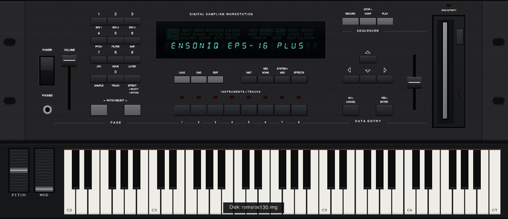

# Ensoniq EPS-16 Plus Emulator



A hardware-level emulator of the **Ensoniq EPS-16 Plus** (rack) sampler. It runs the original ROM and
boots the original operating system from a floppy image, on an emulated 68000 CPU, ES5505 (OTIS)
sound chip, ES5510 (ESP) effects DSP, DMA controller, floppy controller and SCSI. Nothing of the OS is
faked, so it behaves like the real instrument.

Available as an app for **Windows** and **macOS** (Apple Silicon and Intel), and as a **VST3 instrument plug-in**
for both.

## What works

- Boot from the OS floppy (tested with OS 1.30), loading and saving instruments, banks and sequences.
- 20-voice sound engine with the ESP effects.
- Sampling from your audio interface (or a WAV file) at 44.6 / 29.8 / 22.3 / 17.9 kHz, with the input
  level meter.
- Sequencer with correct tempo, MIDI In/Out.
- SCSI option (ZuluSCSI-style images): detection at boot, CHANGE STORAGE DEVICE, FORMAT SCSI DRIVE.
- Import of **Ensoniq Mirage** sounds from Mirage disk images (440 KB `.img`): Command › System/MIDI ›
  LOAD MIRAGE-DSK SOUND.
- OEX-6 Output Expander outputs (AUX 1, BUS 2, BUS 3) on separate outputs of your audio interface.
- Patch Select buttons, Volume and Data Entry sliders, the full rack front panel and an on-screen
  keyboard.

## Download

Get the latest release from the [Releases](../../releases) page.

**Windows** (64-bit): **EPS16-Plus-Emulator-Windows.zip**

| File | What it is |
|---|---|
| `eps16.exe` | the emulator |
| `eps16-cli.exe` | command-line version (tests, rendering to WAV) |
| `VST3/EPS16.vst3` | the VST3 instrument plug-in |
| `roms/`, `scsi/` | where your ROMs/OS disk and SCSI disk images go |

**macOS** (universal: Apple Silicon and Intel, macOS 11 or later): **EPS16-Plus-Emulator-macOS.zip**

| File | What it is |
|---|---|
| `EPS-16-Plus.app` | the emulator |
| `eps16-cli` | command-line version |
| `VST3/EPS16.vst3` | the VST3 instrument plug-in |
| `roms/`, `scsi/` | where your ROMs/OS disk and SCSI disk images go |

### macOS: what you need to know

1. **Keep the folder together.** Unzip and keep `EPS-16-Plus.app` with the `roms` and `scsi` folders next to
   it (the folder can go anywhere, e.g. in Applications or Documents): the app looks for them there.
2. **Allow the app to open, once.** The app is not notarized by Apple, so macOS refuses to open it
   ("cannot verify ..."). In Terminal, type `xattr -dr com.apple.quarantine ` (with a space at the end),
   drag the unzipped folder onto the window and press Enter. This also covers the plug-in.
   (Alternatively open the app once, then System Settings › Privacy & Security › **Open Anyway**.)
3. **ROMs and OS disk** go in `roms/` (see below). If they are not found, the app lists the folders it
   searched and offers **Choose folder…**; the folder you pick is remembered.
4. **Audio input** (sampling, Audio Tracks): macOS asks for microphone access the first time; allow it
   (or later in System Settings › Privacy & Security › Microphone).
5. **Menus:** File and View are in the macOS menu bar (⌘O open disk, ⌘E eject, ⌘S save disk changes,
   ⌘R reset, ⌘K keyboard, ⌘, options). The Ctrl shortcuts listed below work too.
6. **Plug-in:** copy `VST3/EPS16.vst3` to `~/Library/Audio/Plug-Ins/VST3/` (Finder: Go › Go to Folder…)
   and open the app once first. More details: `README.txt` in the package.

## You need your own ROM and OS disk

The ROM and the operating system belong to Ensoniq/E-mu and are **not included**. Put them in the
`roms` folder next to `eps16.exe` (Windows) or `EPS-16-Plus.app` (macOS):

- the two EPROMs: `eps16plus-u28.bin` (U28, even bytes) and `eps16plus-u27.bin` (U27, odd bytes);
- the OS floppy image `os130.img` (or any single `.img` in that folder).

## Using it

- **Disks:** drag a floppy image (`.img`, or a Giebler `.ede` / `.eda` image) onto the window, or one or more instruments (`.efe`): they
  are put on a temporary floppy in the drive, then use LOAD as usual. The drive's eject button ejects.
  File › Save Disk Changes (Ctrl+S) writes the floppy back to its image.
- **Record a song to WAV:** File › Record Song to WAV… (Ctrl+W; ⇧⌘R on the Mac). Choose the folder; the
  recording then waits and starts when you press **Play** on the sequencer, and ends when the song
  ends or you press Stop (it goes on until the sound has died away). The file is 24-bit stereo at the
  audio device's sample rate and gets the name of the song / sequence, as shown on the Seq•Song page
  (open that page once so that the name is known; otherwise the file gets a generic name).
  Ctrl+W again cancels or stops.
- **Power:** hold the Power button for about 1 s to restart the machine (or File › Reset).
- **Boot from SCSI:** Options › SCSI drives › *Boot from* › "SCSI drive (no floppy at start)" starts the
  machine with an empty floppy drive, booting from a SCSI drive that has the OS on it (command line:
  `--boot scsi` / `--boot floppy`, this run only). The OS disk image is only ever taken from the `roms`
  folder next to the program: nothing is fetched from `%APPDATA%`, so deleting it there removes it.
- **Mirage disks:** a 440 KB Ensoniq Mirage disk image (80 tracks, 1 side, 5 x 1024 + 512-byte sectors) can go in the floppy drive: Command › System/MIDI › *LOAD MIRAGE-DSK SOUND* imports its sounds (the OS asks for the OS disk first, then for the Mirage disk).
- **SCSI activity LED:** the red LED above the floppy drive blinks while the SCSI bus is in use: slowly while reading, fast while writing.
- **ROMs not found:** the program lists the folders it searched and offers "Choose folder..."; the chosen folder is remembered (the plug-in uses it too).
- **Up + Down together** jumps to the middle of the value's range (0 for -99..+99, 50 for 0..99), as
  on the real unit: right-click an arrow, or press both arrow keys.
- **MIDI:** the supplied OS disk is set to MIDI MULTI (instruments 1-8 on channels 9-16); by default
  MIDI In is sent to the "Keyboard channel" (9) set in the options.
- **Options** (View › Options, Ctrl+O): audio driver (Windows: WASAPI, DirectSound, ASIO...; macOS: Core Audio), outputs, sample
  rate, buffer, OEX-6 outputs, sampler input, MIDI ports and channel, and
  the SCSI drives folder. Settings are kept in `%APPDATA%\Ensoniq\EPS16emu\eps16.cfg` (macOS: `~/Library/Application Support/Ensoniq/EPS16emu/eps16.cfg`).

**Computer keyboard** (it does not play notes: use a MIDI keyboard or the on-screen keyboard):

| Key | Function |
|---|---|
| 1–8, F1–F8 | instrument buttons 1–8 |
| numeric keypad | page buttons as printed: 1 Env 1 … 4 Pitch … 9 Layer, 0 Track |
| R / Space | RECORD / PLAY |
| Arrows | panel arrows |
| Enter / Esc | YES•ENTER / NO•CANCEL |
| F11 / F12 | left / right Patch Select |
| F9 | show/hide the on-screen keyboard |
| Ctrl+E / Ctrl+S / Ctrl+R | eject / save the floppy / reset |
| Ctrl+F / Ctrl+I | effects on/off / audio input on/off |

## SCSI drives

Put disk images named like on a ZuluSCSI in a folder: `HD0.img` is a hard disk on SCSI ID 0,
`CD5.iso` a CD-ROM on ID 5, and so on. By default the emulator uses a `scsi` folder next to it;
choose another one in Options › SCSI drives.

**New formatted drives:** in Options › SCSI drives pick a size (50 MB to 2 GB) and click
**Create HDn.img**. The image is created on the first free SCSI ID, already formatted as the EPS's
FORMAT SCSI DRIVE does it, so it is ready to use. Reset the EPS so that the OS sees new drives.

## VST3 plug-in

1. Copy the whole `VST3\EPS16.vst3` folder to `C:\Program Files\Common Files\VST3` (Windows) or to
   `~/Library/Audio/Plug-Ins/VST3/` (macOS).
2. Run the app (`eps16.exe` / `EPS-16-Plus.app`) once: the plug-in then uses the same ROMs, OS disk, SCSI folder and settings as
   the app (including the MIDI channel: host notes go to channel 9 by default).
3. Rescan plug-ins in your host and load **EPS-16 Plus Emulator** as an instrument.

- Outputs: Main plus AUX 1, BUS 2 and BUS 3 (enable them in the host to get them separately); a
  stereo input for sampling; MIDI In and MIDI Out.
- The editor is just the panel: click the drive slot to choose a disk image (`.img`, `.ede`, `.eda`) or
  instrument files, or drag them onto the panel (where the host passes drops on to plug-ins), use the drive's eject
  button and the Power button, as in the app.
- The plug-in has no settings of its own: change them in the app and the plug-in follows.
- The project stores the volume and the disks in use; on reopening the EPS boots again with them
  (RAM contents are not saved: load your sounds, as on the real unit).

## Building

Needs a C++17 compiler, CMake and SDL2 (or `-DEPS16_BUNDLED_SDL=ON` to build it from source).

```sh
cmake -S . -B build && cmake --build build -j          # app and command-line version
cmake -S plugin -B build-vst && cmake --build build-vst # VST3 plug-in (downloads the VST3 SDK)
```

macOS (universal: Apple Silicon and Intel): `./build-mac.sh` builds `EPS-16-Plus.app` and the VST3 plug-in into `dist/` (see
`README-MAC.txt`); the `macOS` GitHub Actions workflow does the same on a Mac runner.

Cross-compiling for Windows from Linux: see `mingw64.cmake.example` and `build-vst-win-mingw.sh`.
Technical notes (emulated hardware, memory map, code layout), in Portuguese:
[docs/TECHNICAL-pt.md](docs/TECHNICAL-pt.md).

## Credits and licences

- **Musashi** 68000 core by Karl Stenerud; **ES5505/ES5510** algorithms derived from MAME
  (BSD-3-Clause); **RtMidi/RtAudio** by Gary P. Scavone; **SDL2** (zlib); **VST3 SDK/VSTGUI** by
  Steinberg (MIT); panel lettering drawn with GNU FreeSans. With ASIO support the Windows build is
  under GPLv3 (ASIO SDK). See `LICENSES/`.
- VST and ASIO are trademarks of Steinberg Media Technologies GmbH.
- Ensoniq and EPS-16 Plus are trademarks of their owners. This project is not affiliated with them;
  the ROM and OS are not included.
